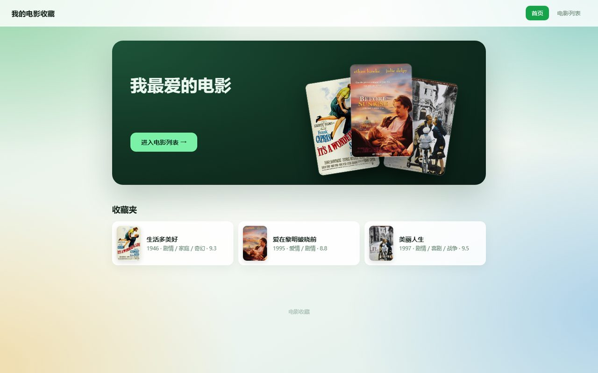
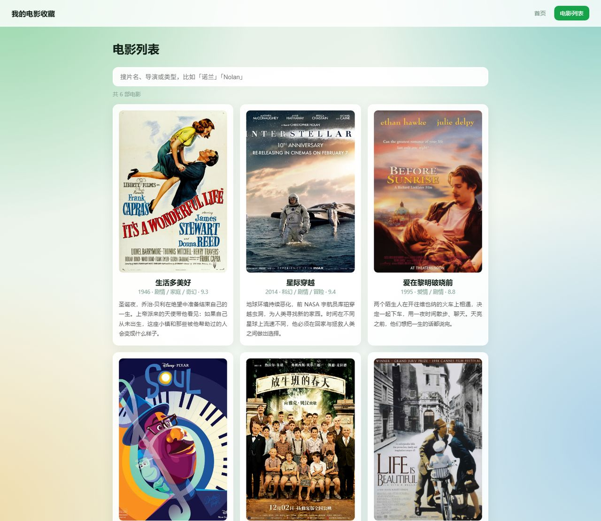
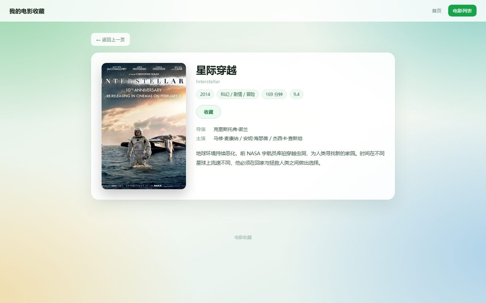

# 我的电影收藏

一个用 React 构建的单页电影收藏应用：浏览电影、搜索、查看详情，并把喜欢的电影收藏起来。收藏状态保存在浏览器本地，刷新不会丢失。

- 🔗 在线体验：<https://macoto-wcr.github.io/movie-collection/>
- 💻 源码：<https://github.com/macoto-wcr/movie-collection>



## 功能

- **首页**：主视觉 + 收藏夹，收藏的电影会实时出现在下方
- **电影列表**：卡片式布局，支持按片名、英文名、导演（中英文）、类型搜索
- **详情页**：海报、评分、年份、片长、导演、主演、剧情简介
- **收藏**：详情页一键收藏 / 取消，状态持久化到 `localStorage`
- **搜索可分享**：关键词写入网址（`#/movies?q=Nolan`），刷新、复制链接都不会丢
- **响应式**：桌面三列、手机单列，主视觉海报自动缩放
- **404 兜底**：错误网址有友好提示

## 页面预览

| 电影列表 | 详情页 |
| --- | --- |
|  |  |

手机端：


## 技术栈

| 技术 | 用途 |
| --- | --- |
| React 18 | 组件、状态、渲染 |
| React Router v5 | `HashRouter` 多页面路由 |
| Babel Standalone | 浏览器内编译 JSX |
| 原生 CSS | Grid / Flex / 渐变背景 / 响应式 |
| localStorage | 收藏数据持久化 |
| GitHub Pages | 静态部署 |

> 项目刻意使用 `<script>` 引入的 UMD 版本，不依赖构建工具，方便直接阅读和运行。

## 项目结构

```
movie-collection/
├── index.html          # 页面结构、样式、React 代码
├── lib/                # react、react-dom、react-router-dom、babel
├── img/                # 六部电影的海报
├── screenshots/        # README 配图
└── README.md
```

## 本地运行

直接双击 `index.html` 即可打开。

也可以启动一个静态服务器：

```bash
python -m http.server 8080
```

然后访问 <http://localhost:8080>。

## 实现要点

- **状态提升**：收藏列表放在根组件 `App` 中，通过 props 传给首页和详情页，避免多份状态不同步。
- **网址作为单一数据源**：搜索词不存 `useState`，而是写入 `?q=` 查询参数；刷新、前进后退、分享链接都能还原。
- **持久化**：收藏的 id 数组写入 `localStorage`，首次访问用数据里的默认收藏作为初始值。
- **HashRouter**：静态托管（GitHub Pages、`file://`）下不需要服务器重写规则，直接可用。
- **响应式**：CSS Grid 的 `auto-fill + minmax` 自动列数，海报宽度使用 `clamp()`，窄屏隐藏/重排主视觉。
- **性能取舍**：背景最初使用 `filter: blur()` + `backdrop-filter` 的实时模糊，滚动明显掉帧；改为预渲染的柔和渐变与半透明表面，视觉接近但滚动更顺。

## 添加电影

编辑 `index.html` 里的 `MOVIES` 数组，新增一条数据并把海报放进 `img/`：

```js
{
  id: 7,
  title: "你的电影",
  en: "Your Movie",
  year: 2024,
  genre: "剧情",
  director: "导演",
  directorEn: "Director",
  cast: "主演",
  duration: 120,
  rating: 8.0,
  poster: "./img/your-poster.webp",
  synopsis: "一句话简介。",
}
```

## 后续计划

- [ ] 迁移到 Vite + React Router v6
- [ ] 使用 TypeScript 重写
- [ ] 接入真实电影 API
- [ ] 增加收藏筛选与排序

## 说明

本项目为个人学习作品，电影海报版权归原片方所有。
